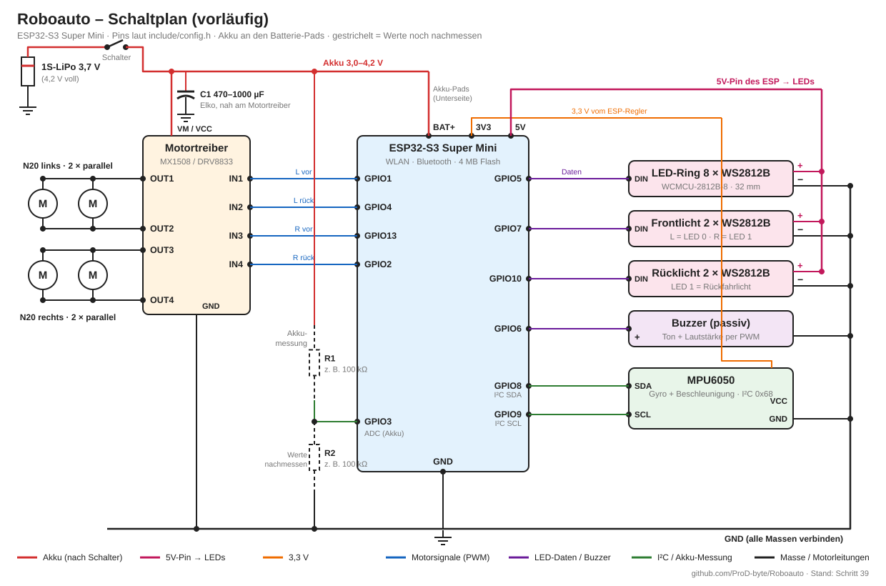

# 🚗 Roboauto

Ein kleines Roboterauto mit Panzerlenkung (4 Räder, Skid-Steer) mit **ESP32-S3 Super Mini**, gesteuert per **Handy-App (Dabble, Bluetooth)** oder im **Browser über WLAN**.
Geschrieben mit **VS Code + PlatformIO**, Schritt für Schritt aufgebaut.

## ✨ Funktionen

| | |
|---|---|
| 🎮 **Steuerung** | Dabble-App (Joystick, Steuerkreuz, Neigungssteuerung) oder Weboberfläche mit Joystick und Tastatur (W A S D) |
| 🌐 **Weboberfläche** | modernes Dashboard: Live-Ansicht des Autos, Kompass, Neigung, Motorleistung, Akkuverlauf · Deutsch/Englisch |
| 🧭 **Gyro (MPU6050)** | Geradeauslauf, 180°-Wende auf Knopfdruck, Kompass, Crash- und Umkipp-Erkennung |
| 💡 **Licht** | Front-/Rücklicht, Fernlicht, Blinker, Warnblinker, Bremslicht, LED-Ring mit Animationen |
| 🚨 **Modi** | Normal, Polizei (Blaulicht + Sirene), Team Blau/Grün/Gelb/Rot |
| ✨ **Programme** | Figuren (Quadrat, Acht, Slalom), Fahrweg aufnehmen und abspielen, Balancieren (Experiment) |
| 🎵 **Jukebox** | Chiptune-Musik über den Buzzer mit Lichtshow auf dem LED-Ring |
| 📶 **WLAN** | Einrichtung per Handy (Netz „Roboauto-Setup“), merkt sich bis zu 8 Netzwerke, Updates über WLAN (OTA) |
| 🔧 **Einstellungen** | Tempo, Lenkung, Helligkeit, Lautstärke, Töne, Motor-Richtung mit Motortest-Assistent |

## 🔌 Hardware

- ESP32-S3 Super Mini (4 MB Flash)
- 4 × N20-Getriebemotor 1000 U/min, Motortreiber (MX1508 / DRV8833)
- MPU6050 (Gyro + Beschleunigung)
- WS2812-LED-Ring (8 LEDs) + Front-/Rücklicht-LEDs
- Passiver Buzzer
- 1S-LiPo 3,7 V (Tipp: 470–1000 µF Elko an die Motorversorgung)

Alle Pins stehen in [`include/config.h`](include/config.h).

### Schaltplan (vorläufig)

| ESP32-S3 | Anschluss an | Funktion |
|---|---|---|
| GPIO1 | Motortreiber IN1 | Motoren links vorwärts (PWM) |
| GPIO4 | Motortreiber IN2 | Motoren links rückwärts (PWM) |
| GPIO13 | Motortreiber IN3 | Motoren rechts vorwärts (PWM) |
| GPIO2 | Motortreiber IN4 | Motoren rechts rückwärts (PWM) |
| GPIO5 | LED-Ring DIN | 8 × WS2812B |
| GPIO7 | Frontlicht DIN | 2 × WS2812B (LED 0 links, LED 1 rechts) |
| GPIO10 | Rücklicht DIN | 2 × WS2812B (LED 1 = Rückfahrlicht) |
| GPIO6 | Buzzer + | passiver Buzzer, Ton und Lautstärke per PWM |
| GPIO8 | MPU6050 SDA | I²C, Adresse 0x68 |
| GPIO9 | MPU6050 SCL | I²C |
| GPIO3 | Spannungsteiler-Mitte | Akkuspannung (ADC) |
| 5V | Akku (nach Schalter) | Versorgung ESP |
| 3V3 | MPU6050 VCC | 3,3 V vom ESP |

Die Motoren einer Seite hängen parallel am selben Ausgang. LEDs und Motortreiber laufen direkt am Akku,
alle Massen sind verbunden. **Vorläufig:** Die Werte des Spannungsteilers (R1/R2) und die genaue
Versorgung sind noch nicht nachgemessen. Sind die Motoren falsch herum angeschlossen, hilft der
Motortest-Assistent in der Weboberfläche.

## ⚡ Firmware aufspielen

### Ohne Programmieren – Online-Flasher
Auf der **GitHub-Pages-Seite** dieses Projekts auf „Roboauto installieren“ klicken (Chrome/Edge am PC, Auto per USB-C anschließen).

### Mit VS Code + PlatformIO
1. Repository klonen und den Ordner in VS Code öffnen (PlatformIO-Erweiterung installiert).
2. Vorlagen kopieren:
   - `geheim.beispiel.ini` → **`geheim.ini`** (Passwort für WLAN-Updates eintragen oder leer lassen)
   - `include/wlan_zugang.beispiel.h` → **`include/wlan_zugang.h`** (kann leer bleiben)
3. In `platformio.ini` den COM-Port anpassen (`upload_port`, `monitor_port`).
4. Umgebung **`env:roboauto`** wählen → Upload (→).
5. Spätere Updates ohne Kabel: Umgebung **`env:roboauto_wlan`** → Upload.

> 🔒 `geheim.ini` und `include/wlan_zugang.h` werden **nicht** hochgeladen (siehe `.gitignore`).

## 📱 Erste Schritte

1. Auto einschalten → der LED-Ring leuchtet orange.
2. Mit dem Handy ins WLAN **„Roboauto-Setup“** → die Einrichtungsseite öffnet sich von selbst.
3. Eigenes WLAN wählen, Passwort eingeben, speichern.
4. Im normalen WLAN **http://roboauto.local** öffnen – fertig.

Oder: Dabble-App öffnen, mit **„RoboautoV3“** verbinden, GamePad-Modul wählen.

## 🤖 Automatischer Build (GitHub Actions)

Bei jedem Hochladen baut GitHub die Firmware automatisch:

- **Actions** → Lauf anklicken → **Artifacts**: `roboauto-komplett.bin` (Neuinstallation) und `roboauto-update.bin` (Update)
- Ein **Tag** wie `v1.0.0` erstellt ein **Release** mit beiden Dateien.
- Der **Online-Flasher** (GitHub Pages) bekommt automatisch die neueste Version.

## 📚 Verwendete Bibliotheken

- [DabbleESP32](https://github.com/STEMpedia/DabbleESP32) (STEMpedia, LGPL-3.0) – angepasste Kopie in `lib/DabbleESP32`
- [Adafruit NeoPixel](https://github.com/adafruit/Adafruit_NeoPixel)
- [ESP Web Tools](https://esphome.github.io/esp-web-tools/) für den Online-Flasher

Die Musikstücke der Jukebox sind gemeinfrei (Volkslied/Klassik) oder eigene Kompositionen.
Zusätzlich enthalten (Lizenz **CC0**, aus MIDI umgerechnet):
- „15 Melodic RPG Chiptunes“ von **Aureolus Omicron** – [OpenGameArt](https://opengameart.org/content/15-melodic-rpg-chiptunes) (Title Screen, Airship, Battle 2, Town)
- „Theme Song [8-bit]“ und „Leap 8-bit“ von **nene** – [OpenGameArt](https://opengameart.org/content/theme-song-8-bit), [OpenGameArt](https://opengameart.org/content/leap-8bit)
- „Long Away Home [8bit]“, „Boss Battle #2“ und „Boss Battle #5“ von **nene** (CC0) – [OpenGameArt](https://opengameart.org/content/long-away-home-8bit), [OpenGameArt](https://opengameart.org/content/boss-battle-2-8-bit), [OpenGameArt](https://opengameart.org/content/boss-battle-5-8-bit)
- „JRPG Collection“ (Main Theme, Battle) von **Yubatake** – Lizenz [CC-BY 4.0](https://creativecommons.org/licenses/by/4.0/), [OpenGameArt](https://opengameart.org/content/jrpg-collection); für den Buzzer umgerechnet und gekürzt
- „4 Music Box Tracks“ (Sad Tune, Spooky Waltz) und „Bittersweet Story“ von **Aureolus Omicron** (CC0) – [OpenGameArt](https://opengameart.org/content/4-music-box-tracks)
- „Princess“ und „Lullaby“ von **Yubatake** – [CC-BY 4.0](https://creativecommons.org/licenses/by/4.0/), [OpenGameArt](https://opengameart.org/content/lullaby-1)
- „Destiny Formation“ von **Bobjt** (CC0) – [OpenGameArt](https://opengameart.org/content/destiny-formation)
- „Weiße Taube“ – © ProDMusicKI (eigener Song)
