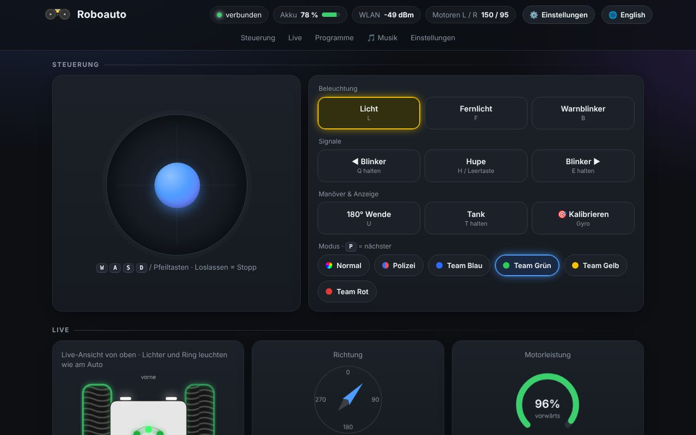

# 🚗 Roboauto

Ein kleines Roboterauto mit Panzerlenkung – selbst konstruiert, 3D-gedruckt und programmiert.
Gesteuert per **Handy-App (Dabble, Bluetooth)** oder im **Browser über WLAN**.

## 📁 Was liegt wo?

| Ordner / Dateien | Inhalt |
|---|---|
| [`Codes/roboauto_pio`](Codes/roboauto_pio) | **Aktuelle Firmware** (VS Code + PlatformIO) – mit eigener [Anleitung](Codes/roboauto_pio/README.md) |
| [`3D-Druck`](3D-Druck) | **Aktuelle 3D-Druckteile**: Unterteil V5, Wanne V4, Brücke V6, Oberteil 32mm Ledring V.2, Kugel, Ledrinhalter, Schalter-Halter – `.skp` = SketchUp-Modell, `.stl` = zum Drucken |
| [`3D-Druck/alte Versionen`](3D-Druck/alte%20Versionen) | Frühere Stände der Druckteile (nur zum Nachschauen) |
| [`Modell`](Modell) | Komplettes Auto als 3D-Modell (`Roboauto Version 6.skp`, mit Platine: `Roboauto Version Platine.skp`) |
| [`Platine`](Platine) | Platine als 3D-Modell und Pinbelegung (`XIAO_ESP32_C6_Roboter_Pinbelegung.xlsx`) |
| [`Platine/Schaltplan_XIAO_ESP32-C6.pdf`](Platine/Schaltplan_XIAO_ESP32-C6.pdf) | **Schaltplan mit Seeed Studio XIAO ESP32-C6** (A3, auch als SVG; neu erzeugen mit `python schaltplan_xiao.py`) |
| `Codes/roboauto_pio/docs/bilder` | Screenshots der Weboberfläche |

> Fremde 3D-Modelle aus dem Internet (Räder, Schrauben, LED-Ring, Boards …) liegen lokal im Ordner `Fremdteile` und sind hier **nicht** enthalten – die gibt es bei den jeweiligen Herstellern bzw. auf GrabCAD.

## ⚡ Schnellstart

- **Projektseite:** [daveslab.de/basteln](https://daveslab.de/basteln/)
- **Firmware aufspielen ohne Programmieren:** [Online-Flasher](https://prod-byte.github.io/Roboauto/)
- **Selbst bauen:** siehe [Firmware-Anleitung](Codes/roboauto_pio/README.md)

## 🤖 Automatischer Build

Ändert sich etwas in `Codes/roboauto_pio`, baut GitHub die Firmware automatisch (Reiter **Actions**) und aktualisiert den Online-Flasher.
Ein Tag wie `v1.0.0` erzeugt ein Release mit den fertigen Dateien.
