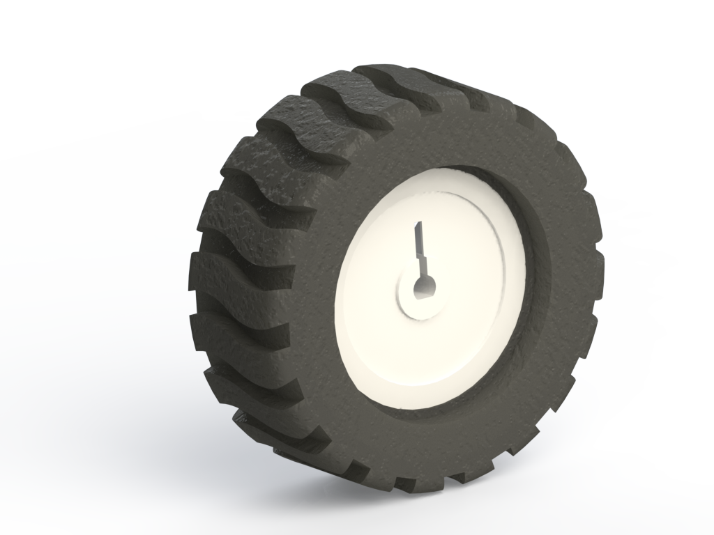

# 🚗 Roboauto

Ein kleines Roboterauto mit Panzerlenkung – selbst konstruiert, 3D-gedruckt und programmiert.
Gesteuert per **Handy-App (Dabble, Bluetooth)** oder im **Browser über WLAN**.

## 📁 Was liegt wo?

| Ordner / Dateien | Inhalt |
|---|---|
| [`Codes/roboauto_pio`](Codes/roboauto_pio) | **Aktuelle Firmware** (VS Code + PlatformIO) – mit eigener [Anleitung](Codes/roboauto_pio/README.md) |
| `Codes/roboauto_finalv5`, `Codes/roboauto_finalv6` | Ältere Arduino-Versionen (nur zum Nachschauen) |
| `Roboauto Unterteil*`, `Oberteil*`, `Wanne*`, `Brücke*`, `Kugel`, `Ledrinhalter`, `Schalter Halter` | **3D-Druckteile** – `.skp` = SketchUp-Modell, `.stl` = zum Drucken |
| `Roboauto Version 6.skp`, `Roboauto Version Platine.skp` | Komplettes Auto als 3D-Modell |
| `Robo Auto Platine.skp`, `OBJ_PCB_RoboAutoPlatine.skp`, `3D_PCB_…skp` | Platine als 3D-Modell |
| `Render1.png`, `Render2.png` | Bilder vom Auto |
| `XIAO_ESP32_C6_Roboter_Pinbelegung.xlsx` | Pinbelegung (Planung) |

> Fremde 3D-Modelle aus dem Internet (Räder, Schrauben, LED-Ring, Boards …) sind hier **nicht** enthalten – die gibt es bei den jeweiligen Herstellern bzw. auf GrabCAD.

## ⚡ Schnellstart

- **Firmware aufspielen ohne Programmieren:** Online-Flasher auf der GitHub-Pages-Seite dieses Projekts
- **Selbst bauen:** siehe [Firmware-Anleitung](Codes/roboauto_pio/README.md)

## 🤖 Automatischer Build

Ändert sich etwas in `Codes/roboauto_pio`, baut GitHub die Firmware automatisch (Reiter **Actions**) und aktualisiert den Online-Flasher.
Ein Tag wie `v1.0.0` erzeugt ein Release mit den fertigen Dateien.
